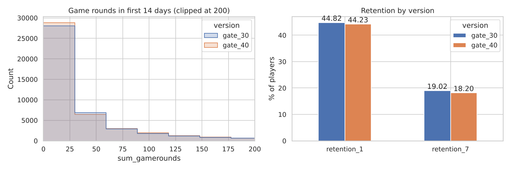
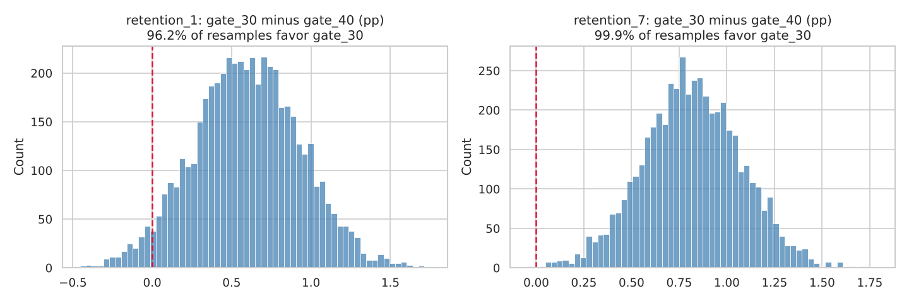

# A/B Test: Moving the First Gate in Cookie Cats

Cookie Cats, a mobile puzzle game, tested moving its first "gate" (a forced pause) from level 30 to level 40 on 90,189 new players. This project analyzes the experiment and recommends whether to make the change.



## Data

One row per player: assigned version (`gate_30` or `gate_40`), game rounds played in the first 14 days, and whether the player returned 1 day and 7 days after install. Source: the public Cookie Cats dataset (DataCamp project, 2018).

## Method

| Step | What I did |
|---|---|
| Sanity checks | Duplicates, missing values, sample ratio mismatch (chi-square), removed one bot-like user with 49,854 rounds |
| Retention | Two-proportion z-test with 95% CI, Holm correction for two metrics |
| Robustness | Bootstrap distribution of the difference; Bayesian beta-binomial model for P(gate 30 is better) |
| Engagement | Mann-Whitney U test, since game rounds are heavily skewed |
| Sensitivity | Minimum detectable effect at 80% power, and sample size needed for the observed effect |

## Results

| Metric | Gate 30 | Gate 40 | Difference | 95% CI | p (Holm) | P(gate 30 better) |
|---|---:|---:|---:|---|---:|---:|
| 7-day retention (primary) | 19.02% | 18.20% | **+0.82 pp** | 0.31 to 1.33 pp | 0.003 | 99.9% |
| 1-day retention | 44.82% | 44.23% | +0.59 pp | −0.06 to 1.24 pp | 0.074 | 96.3% |

- Game rounds: median 17 vs 16, no significant difference (Mann-Whitney p = 0.051).
- The test could detect a 0.73 pp change in 7-day retention with 80% power, so it was large enough for the primary metric.
- Group sizes were 44,700 vs 45,489. That gap is larger than chance usually produces (p = 0.009), so the assignment process should be checked before the next test.



## Recommendation

**Keep the gate at level 30.** Moving it to 40 costs about 0.8 points of 7-day retention (a 4.3% relative drop), and every method used agrees on the direction. A follow-up test at level 20 would show whether an even earlier break helps more.

## How to run

```bash
git clone https://github.com/mehtesham13/ab-test-mobile-game.git
cd ab-test-mobile-game
pip install -r requirements.txt
jupyter notebook ab_test_cookie_cats.ipynb
```

Author: Muhammad Ehtesham · [LinkedIn](https://www.linkedin.com/in/muhammad-ehtesham-dsa)
